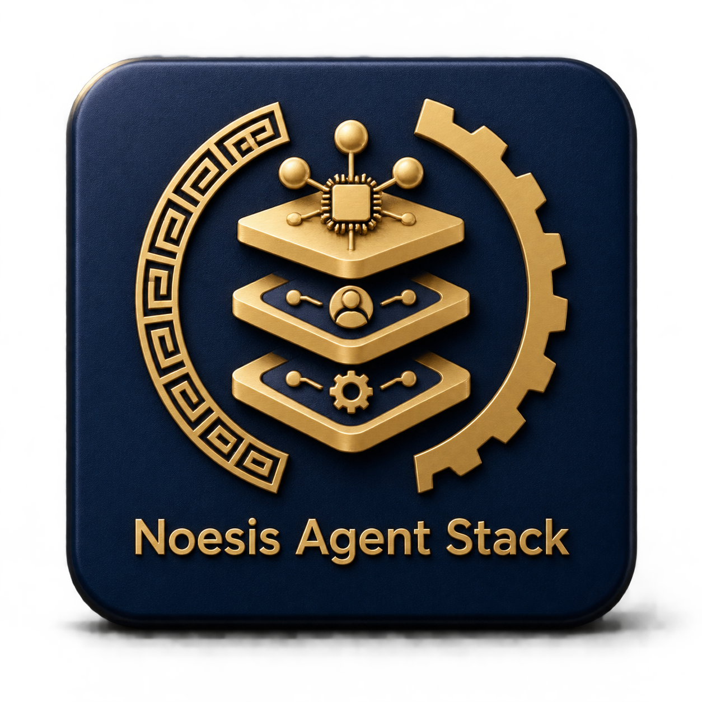

<p align="center">
  
</p>

<p align="center">
  <a href="#"></a>
  <a href="#"></a>
  <a href="#"></a>
  <a href="#"></a>
</p>

---

# Noesis Agent Stack

A production-oriented multi-agent orchestration system built on **Hermes Agent**
profiles. It pairs a durable **task-contract control plane** (the
orchestration engine) with two families of specialized Hermes agent profiles:
the **in-house Noesis fleet** (16 `noesis-*` specialists) and the **third-party
"agency" fleet** (18 advisory Tier A profiles generated from the Agency Agent
Catalog). All specialized work is planned, dispatched, and supervised by the
orchestrator under explicit approval gates; the stack keeps role separation,
durable ledgers, and bounded autonomy at its core.

The stack is deployed and operated through its companion IaC and prompt-cache
repositories (see [Companion repositories](#companion-repositories)).

## What this repository is

This repository holds the definitions, contracts, policies, schemas, and the
orchestration engine that run the Noesis multi-agent system:

- The **orchestration engine** (`orchestration/`) — the control planes that plan,
  dispatch, supervise, and synthesize cross-profile work (see
  [Orchestration engine](#orchestration-engine)).
- The **in-house Noesis agent profiles** (`agents/noesis-*/`, `profiles/`) — the
  native specialist fleet (see [In-house Noesis fleet](#in-house-noesis-fleet)).
- The **third-party "agency" profiles** (`agency/`, generated under
  `agents/agency-*/`) — the advisory Tier A catalog fleet (see
  [Third-party "agency" fleet](#third-party-agency-fleet)).
- Shared policies, schemas, handoff contracts, routing state, and the register of
  deployable profiles.
- The OpenClaw worker definitions and Claude Code bridge retained from the
  original design for the specialized deep-work lanes they still serve.

The core pattern:

- **Noesis Orchestrator** is the long-lived supervisor and routing authority. It
  intakes goals, classifies domain and risk tier, assigns the narrowest-mandate
  specialist, enforces approval gates, and synthesizes results. It holds no
  execution terminal and never performs production, financial, credential, or
  destructive operations itself.
- **Specialist profiles** (both families) consume approved handoffs rather than
  raw external noise, each with an explicit mandate, toolset, and review chain.
- **Reviewers** (Noesis Sentinel, Noesis Skeptic, and reviewer-class agency
  profiles) audit work independently; a finding is not a claim, and a claim is
  not verified knowledge.

## Design principles

- **Supervisor-first control:** Noesis Orchestrator remains the only long-lived
  supervisory and approval authority in the system.
- **Separation of duties:** Orchestrator plans, specialists execute, reviewers
  audit, Scribe archives. No single profile is both implementer and reviewer.
- **Artifacts over chat:** Agents exchange durable files, ledgers, briefs, and
  handoff objects instead of relying on transient chat history as system memory.
- **Least-privilege control plane:** the Orchestrator holds no execution
  authority; irreversible operations are classified `r3`, held at a human
  approval gate, and routed only to a narrowly privileged executor profile.
  See `orchestration/orchestrator/` and `WORKFLOWS.md` §5.
- **Promotion gates:** a finding is not a claim, a claim is not verified
  knowledge, and a signal is not an approved task.
- **Explicit uncertainty:** freshness, contradictions, blocked items, and
  unresolved regressions remain visible rather than being flattened into
  confident summaries.
- **Bounded autonomy:** specialists are advisory or narrowly-privileged; no
  profile makes irreversible external decisions without human approval.

## Orchestration engine

Two control planes live under `orchestration/`:

### noesis-orchestrator — durable task-contract control plane

`orchestration/orchestrator/` is the **planner, dispatcher, supervisor, and
synthesizer** for cross-profile work. It holds **no** `terminal` and **no**
`code_execution` toolset, by roster construction, and never performs production,
financial, wallet, credential, or destructive operations — those are classified
`r3`, held at a human approval gate, and assigned to a narrowly privileged
executor profile.

Key components (see `orchestration/orchestrator/README.md`):

| Path | Purpose |
|---|---|
| `app/models.py` | `TaskContract` and the state machine (`ALLOWED_TRANSITIONS`) |
| `app/registry.py` | Roster-backed profile registry (`profiles/noesis-roster.yaml` + `agents/*/agent.yaml`) |
| `app/policy.py` | Deterministic refusals: assignment, risk, approval, dependency, evidence, staleness |
| `app/store.py` | Append-only JSONL ledger, replayed on start |
| `app/control_plane.py` | `Orchestrator` and `CircuitBreaker` — the only component that mutates state |
| `tests/` | Policy, lifecycle, schema-conformance, and worked-example tests |

Contracts: schema `contracts/orchestration/task-contract.schema.json`; ledger
`workspace/orchestrator/tasks.jsonl` (append-only, one
`{event, recorded_at, task}` record per line, replayed on start); risk tiers
`platform/risk-tiers.yaml`; R3 approval binding
`platform/approval-manifest.schema.json`.

Task lifecycle:

```
proposed -> approved -> queued -> claimed -> running
         -> awaiting_review | blocked | failed | succeeded | cancelled
```

Full transition table, approval gates, operator procedures, recovery, and
emergency stop are in `WORKFLOWS.md` §5. Run the tests with:

```bash
cd orchestration/orchestrator && python -m pytest -q
```

No network, no credentials, and no repository writes: every test uses a
`tmp_path` ledger.

### Broker — OpenClaw worker control plane

`orchestration/broker/` is the sole control plane for managing the OpenClaw
workers (Research, Subconscious) retained for persistent deep-work loops. Hermes
submits typed jobs through this API; the broker validates schemas, enforces
write scopes, tracks state, and emits structured events.

## Agent profiles

The stack routes work across **two families** of Hermes profiles. Both are
registered with the orchestrator and carry explicit roles, toolsets, and review
chains. Reviewer-only profiles (Sentinel, Skeptic) receive no execution
authority.

### In-house Noesis fleet

16 native specialists defined in `profiles/noesis-roster.yaml` (machine-readable
source of truth) and `agents/noesis-*/` (`SOUL.md` + `agent.yaml`), mapped to
Hermes profiles under `~/.hermes/profiles/<name>/`.

| Profile | Role | Tier | Notes |
|---|---|---|---|
| `noesis-orchestrator` | supervisor / router | supervisor | The long-lived control plane; maps to the `default` profile |
| `noesis-steward` | chief-of-staff | primary-operator | Daily triage, prioritization, status |
| `noesis-cartographer` | project-decomposer | primary-operator | Task graphs, dependency mapping, risk, ADRs |
| `noesis-forge` | software-engineer | primary-operator | Code, IaC, CI/CD; reviewed by Noesis Sentinel |
| `noesis-sentinel` | code-reviewer | reviewer-only | Independent code/security review; no execution |
| `noesis-scribe` | knowledge-archivist | primary-operator | KB structure, changelogs, docs |
| `noesis-signal` | research-specialist | specialist | Deep research and multi-source synthesis |
| `noesis-substrate` | infra-engineer | primary-operator | Infra/DevOps/cloud; reviewed by Noesis Sentinel |
| `noesis-tracer` | osint-specialist | specialist | Evidence timelines, labeled fact/allegation/inference |
| `noesis-ledger` | crypto-analyst | specialist | Crypto/mining/DePIN research; never financial advice |
| `noesis-grid` | data-analyst | specialist | Data analysis, spreadsheets, reports |
| `noesis-quill` | technical-writer | specialist | Writing, editing, technical docs |
| `noesis-advocate` | legal-advocacy-support | specialist | Research + drafting support; never legal advice |
| `noesis-herald` | comms-drafter | specialist | Strategic comms drafting; never sends autonomously |
| `noesis-architect` | agent-designer | specialist | Agent/Hermes/MCP/prompt design |
| `noesis-skeptic` | adversarial-reviewer | reviewer-only | Red-team / adversarial QC; no execution |

### Third-party "agency" fleet

18 **advisory-only** Tier A profiles generated from the
[Agency Agent Catalog](https://github.com/msitarzewski/agency-agents) (MIT,
pinned in `agency/SOURCE`), curated one per division. See `agency/README.md`.
All carry the shared advisory posture: `reports_to: noesis-orchestrator`, no
privileged tools, no secret access, no autonomous execution; production /
credential / financial / external-communication actions require human approval.

Wave 1 (8): `agency-engineering-software-architect`, `agency-research-synthesist`,
`agency-security-architect`, `agency-product-manager`, `agency-finance-financial-analyst`,
`agency-project-manager-senior`, `agency-sales-deal-strategist`,
`agency-marketing-seo-specialist`.

Wave 2 (10): `agency-academic-statistician`, `agency-design-ui-finish-gate-reviewer`,
`agency-game-designer`, `agency-gis-technical-consultant`,
`agency-healthcare-clinical-evidence-agent`, `agency-paid-media-auditor`,
`agency-xr-interface-architect`, `agency-specialized-codebase-archaeologist`,
`agency-support-infrastructure-maintainer`, `agency-testing-reality-checker`.

Lineage: `agency/curation.yaml` is the sole roster source; `agency/convert.py`
generates specs; `agency/validate-specs.py` is a three-layer reviewer guard;
`scripts/apply-agency-profiles.sh` materializes them; the `hermes_profiles` role
in the companion Ansible repo drives both fleets from one var. Tier A is capped
at 18 — expanding requires a recorded routing smoke test (`ROUTING-SMOKE.md`).

## Routing and delegation

The specialized-routing path is: **task classification → eligible specialist
discovery → profile selection → policy checks → explicit runtime launch →
identity verification → result validation → supervisor synthesis.** Workflows for
cross-profile execution, plan-first delegation, delegated-task handoff, and
reviewer-gated build development are defined in `WORKFLOWS.md`. Routing smoke
evidence and canary status are recorded in `ROUTING-SMOKE.md`.

## Repository layout

```text
.
├── README.md
├── SPEC.md, WORKFLOWS.md, ROUTING-SMOKE.md, HEARTBEAT.platform.md
├── profiles/
│   ├── noesis-roster.yaml          # in-house fleet (16), machine-readable
│   ├── model-profiles.yaml
│   └── live/                       # sanitized live profile snapshot (config + SOUL)
├── agents/
│   ├── noesis-*/                   # in-house fleet (SOUL.md + agent.yaml)
│   ├── main-hermes/                # original supervisor design
│   ├── research-openclaw/, subconscious-openclaw/
│   ├── noesis-forge/, noesis-clawdev/, claude-code-worker/
│   └── noesis-praxis/              # council/aeon orchestration skill + runbook
│       # agency-*/ profiles are GENERATED (agency/convert.py), not committed:
│       # see agency/README.md — materialized at apply time by
│       # scripts/apply-agency-profiles.sh / the Ansible hermes_profiles role.
├── agency/                         # Agency catalog integration (curation, convert, validate)
├── orchestration/
│   ├── orchestrator/               # durable task-contract control plane
│   └── broker/                     # OpenClaw worker control plane
├── contracts/                      # schemas, handoffs, task-contract, bridge
├── shared/                         # policies, schemas, models, tools
├── platform/                       # routing, risk tiers, approval manifests
├── workspace/                      # orchestrator ledger, per-profile worktrees
├── scripts/                        # apply-agency-profiles, verify-live-config, hooks
├── skills/                         # fleet skill definitions
├── evals/                          # platform evaluations
└── docs/                           # operations, decisions, architecture notes
```

The layout evolves, but the repo preserves strong isolation between the durable
orchestrator ledger, per-profile worktrees, and shared handoff surfaces.

## Companion repositories

The Noesis Agent Stack is deployed and operated alongside two companion
repositories:

- **[NoesisPraxis Ansible Stack](https://github.com/enuno/noesis-ansible)**
  — infrastructure-as-code for deploying, maintaining, and operating the fleet.
  The `hermes_profiles` role drives **both** profile families from a single var
  (`hermes_profiles_fleets`); it also manages the ACP/A2A/MCP registries, agent
  runtimes, observability, and the human-in-the-loop Telegram channel. Agency
  profiles are default-OFF and require explicit enablement
  (`noesispraxis_enable_agency_profiles: true`). Local reference:
  `~/projects/noesis-ansible`.

- **[Noesis Prompt Cache](https://github.com/HashGrid-Networks/noesis-prompt-cache)**
  — the shared prompt-cache and reference prompt set used by the fleet for
  complex agent goals and deployment prompts (ACP/A2A/MCP registries, Telegram,
  OpenClaw, ClawDev/HermesDev). Local reference: `~/projects/hermes-prompt-cache`.

## Safety model

This system is designed around constrained autonomy.

- The Orchestrator plans, routes, and supervises but holds no execution
  terminal; it can never be the privileged executor for `r3` operations.
- Specialists consume approved artifacts, not raw external inputs or weak
  signals, and each carries an explicit mandate and toolset.
- Reviewer-only profiles (Noesis Sentinel, Noesis Skeptic, and reviewer-class
  agency profiles) audit but never execute; review is independent of
  implementation.
- Agency Tier A profiles are advisory-only and require human approval for
  production / credential / financial / external-communication actions.
- Validation, freshness checks, contradiction tracking, release gates, and
  durable-ledger admission (where enforced) block unsupported promotion.

## Status

**Implemented and offline-verified (2026-10-06):** the broker control plane
(`orchestration/broker/`) and the orchestrator control plane
(`orchestration/orchestrator/`) are implemented with passing test suites,
including durable emergency-stop, registry-lane admission, correlated lifecycle
event streams, and structured errors. Validators (inference-routing policy,
Honcho profile definitions, agency catalog names against the pinned upstream
checkout, and live-config compliance via `scripts/verify_live_config.py`) pass.
Evidence: `docs/operations/deployment-verification-2026-10-06.md`.

**Deployed:** in-house profile fleet applied to `~/.hermes`; wave-2/3 in-house
profiles staged on operator go-ahead; the agency Tier A fleet is materialized
via the Ansible role (default-OFF) behind the B2 commit review gate.

**Governance:** the external-review freeze is in effect for the frozen Track A
candidate and revised Track B snapshot; no verdict constitutes installation,
activation, canary, live-goal, commit, push, merge, or deployment approval.

**Verified live (inference):** not yet — blocked on an approved inference
budget. `ROUTING-SMOKE.md` rows remain unrecorded for live lanes.

## Roadmap

1. Complete external independent review of the frozen Track A candidate and the
   revised Track B runtime-enforcement snapshot.
2. Implement and accept the durable TaskStore admission authority
   (`noesis_taskstore_admission/v1`) under a separately authorized plan.
3. Restart/concurrency acceptance for governed runtime enforcement.
4. Full-suite and cross-component integration review in an authorized
   integration workspace.
5. Live-goal execution under an approved inference budget, with reviewer
   eligibility confirmed.
